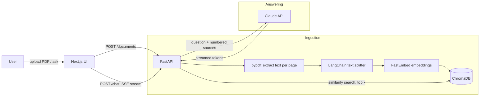

# DocChat: RAG document chatbot

Upload PDFs and ask questions about them. Answers stream in real time and every statement cites the page it came from, so you can check it.

Built with **Python, FastAPI, LangChain, ChromaDB, Claude, Next.js and TypeScript**, and deployable to **AWS** with Docker.

> Demo video: _add your Loom link here_ · Live demo: _add your URL here_

## Features

- **PDF upload** with drag and drop, page-aware chunking, and local embeddings (no extra API key)
- **Grounded answers** from Claude that only use your documents and say so when the answer isn't there
- **Inline citations** like `[1]` that open the exact source passage, file and page
- **Streaming** responses over Server-Sent Events, with a Stop button
- **Multi-turn chat**: follow-up questions keep the conversation context
- **Answers in the user's language** (ask in Vietnamese, get Vietnamese)
- Tests for the backend and frontend, GitHub Actions CI, and Docker Compose deployment

## Architecture



**How a question is answered**

1. The question is embedded and the top 5 most similar chunks are retrieved from ChromaDB (cosine similarity).
2. The chunks are numbered and sent to Claude with the question and recent chat history.
3. The system prompt tells Claude to answer only from those sources and cite them as `[n]`.
4. The API streams `sources`, then `token` events, then `done`. The UI turns `[n]` into clickable citations.

## Run locally

Requirements: Python 3.12+, Node 22+, and an [Anthropic API key](https://console.anthropic.com).

**Backend**

```bash
cd backend
python -m venv .venv && source .venv/bin/activate
pip install -r requirements-dev.txt
cp .env.example .env        # add your ANTHROPIC_API_KEY
uvicorn app.main:app --reload --port 8000
```

**Frontend**

```bash
cd frontend
npm install
cp .env.example .env.local
npm run dev
```

Open http://localhost:3000, upload a PDF, and ask a question.

**Or with Docker**

```bash
cp backend/.env.example backend/.env   # add your key
docker compose up --build
```

## API

| Method | Path | Description |
|---|---|---|
| `POST` | `/documents` | Upload a PDF (multipart `file`). Returns id, pages and chunk count. |
| `GET` | `/documents` | List uploaded documents. |
| `DELETE` | `/documents/{id}` | Remove a document and its chunks. |
| `POST` | `/chat` | `{ "question": "...", "history": [...] }`. Streams SSE events: `sources`, `token`, `done`, `error`. |
| `GET` | `/health` | Health check. |

Interactive docs at http://localhost:8000/docs.

## Configuration

All settings are environment variables (see `backend/.env.example`):

| Variable | Default | Purpose |
|---|---|---|
| `ANTHROPIC_API_KEY` | | Claude API key |
| `CLAUDE_MODEL` | `claude-opus-5-5` | Model used for answers |
| `CLAUDE_EFFORT` | `low` | Reasoning effort. `low` keeps chat fast and cheap; raise it for harder documents |
| `EMBEDDING_MODEL` | `BAAI/bge-small-en-v1.5` | FastEmbed model. For Vietnamese-heavy documents try a multilingual model such as `intfloat/multilingual-e5-large` |
| `TOP_K` | `5` | Chunks retrieved per question |
| `CHUNK_SIZE` / `CHUNK_OVERLAP` | `1000` / `150` | Text splitting, in characters |
| `MAX_UPLOAD_MB` | `20` | Upload size limit |
| `CORS_ORIGINS` | `http://localhost:3000` | Allowed web origins, comma separated |

## Tests

```bash
cd backend && pytest -q        # ingestion, retrieval, API and streaming (Claude is mocked)
cd frontend && npm test        # SSE stream parser
```

## Deploy

See [docs/deploy-aws.md](docs/deploy-aws.md) for a step-by-step AWS EC2 guide.

## Project structure

```
backend/
  app/config.py     settings from env
  app/ingest.py     PDF -> page-aware chunks -> vector store
  app/store.py      embeddings + ChromaDB
  app/rag.py        retrieval, prompt, streaming Claude answer
  app/main.py       FastAPI routes and SSE
  tests/
frontend/
  components/Chat.tsx    upload, document list, chat, source panel
  components/Answer.tsx  renders answers and citation chips
  lib/api.ts, lib/sse.ts API client and SSE parser
docs/deploy-aws.md
docker-compose.yml
```

## Ideas to extend

- Hybrid search (BM25 + vectors) and reranking for better recall
- OCR for scanned PDFs
- User accounts so each person sees only their own documents
- Evaluation set to measure answer accuracy over time

## License

MIT
